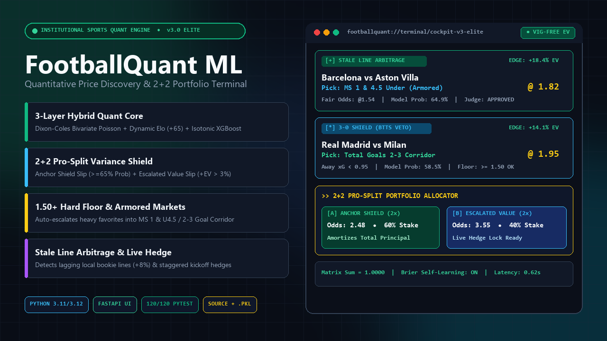
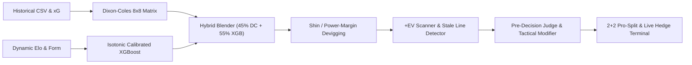
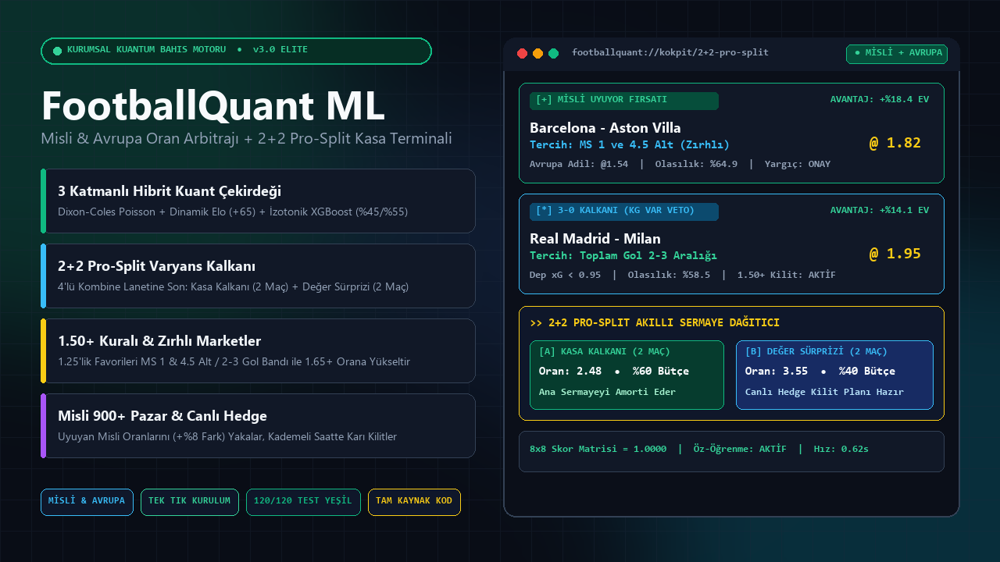

# ⚽ FootballQuant ML (v3.0 Elite) — Quantitative Sports Modeling & 2+2 Portfolio Terminal

[-FF90E8?style=for-the-badge&logo=gumroad&logoColor=black)](https://ulasdursun.gumroad.com/l/footballquant-ml)

> 🌍 **[English Below](#-english-overview--architecture)** | 🇹🇷 **[Türkçe Detaylar Aşağıda](#-türkçe-genel-bakış-ve-mimari)**

---

## 🌐 English Overview & Architecture

**Stop betting with gut feelings and naive 4-leg accumulators.**  
**FootballQuant ML (v3.0 Elite)** is an institutional-grade quantitative football modeling engine and portfolio management terminal inspired by the mathematical syndicate models of **Tony Bloom (Starlizard)** and **Matthew Benham (Smartodds)**.

👉 **[Download Full Source Code + Pre-Trained `.pkl` Models on Gumroad ($99 One-Time)](https://ulasdursun.gumroad.com/l/footballquant-ml)**

### 🔥 Key Quantitative Capabilities
1. **3-Layer Hybrid Quant Core:**
   - **Dixon-Coles Bivariate Poisson:** Generates an $8 \times 8$ exact scoreline probability matrix ($\sum M_{i,j} = 1.0000$) with low-score dependency parameter $\tau(x, y, \rho, \lambda, \mu)$ and temporal split (1st Half $\approx 44\%$, 2nd Half $\approx 56\%$).
   - **Dynamic Elo Rating Engine:** Weekly updated team ratings incorporating $+65$ home-field advantage and logarithmic goal-margin multipliers.
   - **Isotonic Calibrated XGBoost (`45% DC + 55% XGB` Blender):** Zero-lookahead `TimeSeriesSplit` pipeline trained on historical match & xG data.
2. **Shin & Power-Margin Devigging:**
   - Strips bookmaker overround (vig) from sharp Pinnacle & Bet365 lines to extract true fair probabilities ($P_{\text{fair}}$) and Positive Expected Value ($+EV = P_{\text{model}} \times \text{Odds} - 1 > 3\%$).
3. **2+2 Pro-Split Variance Shield:**
   - Eliminates the *4-Match Parlay Curse* ($0.65^4 \approx 17.8\%$ hit rate / $82.2\%$ loss rate) by dividing capital into two independent 2-leg slips:
     - 🛡️ **Anchor Shield Slip (2 Legs):** High probability ($\ge 65\%$), armored markets, principal protection target.
     - 🚀 **Escalated Value Slip (2 Legs):** High $+EV$ edge, controlled variance for upside growth.
4. **1.50+ Hard Floor & Armored Market Escalator:**
   - Rejects low-value heavy favorites ($< 1.50$ odds) and automatically upgrades them into **Armored Combinations** (`Home Win & Under 4.5 Goals`, `2-3 Goal Band`, `Double Chance 1X/X2`, `Draw No Bet`).
5. **Stale Line Arbitrage & Live Hedge Calculator:**
   - Detects lagging local bookmaker odds vs. European sharp drops and calculates exact risk-free live hedge stakes for staggered kickoff times.
6. **Pre-Decision LLM Judge & Self-Learning Brier Loop:**
   - Clashes the top 3 candidate markets per match to justify trade-offs (`Groq` / `Gemini` gateway with deterministic fallback) and dynamically updates market trust weights (`data/market_trust_weights.json`) via Brier score penalties/rewards.

### 🏗️ System Architecture

### 📦 What Is Included in the Full Source Package?
- Complete **Domain-Driven Design (DDD)** Python codebase (`src/domain`, `src/application`, `src/infrastructure`, `src/api`, `src/tests`).
- Pre-trained **`.pkl` Models** (`quant_engine.pkl`, `feature_engineer.pkl`, isotonic XGBoost models) & historical league CSV datasets.
- **FastAPI Dark OLED Web Cockpit** with 7 modular ES6 front-end controllers (`terminal.js`, `pro_split_ui.js`, `deepdive.js`, `misli_importer.js`, `slip_doctor_ui.js`, `pnl_ledger.js`, `slip_manager.js`).
- **1-Click Launchers:** `start_terminal.bat` (Windows) and `start_terminal.sh` (macOS/Linux).
- **120/120 Passing Automated Pytest Suite** (`pytest src/tests/`).

👉 **[Get Instant Access on Gumroad ($99)](https://ulasdursun.gumroad.com/l/footballquant-ml)**

---

## 🇹🇷 Türkçe Genel Bakış ve Mimari

**İçgüdüyle bahis oynamayı ve %82.2 kaybettiren 4 maçlık kombine tuzaklarını bırakın.**  
**FootballQuant ML (v3.0 Elite)**; Tony Bloom (*Starlizard*) ve Matthew Benham (*Smartodds*) kuant ekolünden ilham alan, **Misli / İddaa bülteni ve Avrupa keskin oranlarıyla (Pinnacle/Bet365)** tam uyumlu kurumsal bir spor analitiği ve portföy yönetim terminalidir.

👉 **[Tam Kaynak Kod + Eğitilmiş Modelleri Gumroad Üzerinden Hemen İndirin ($99)](https://ulasdursun.gumroad.com/l/footballquant-ml)**

### 🛡️ 8 Temel Kuant ve Kasa Koruma Özelliği
1. **3 Katmanlı Hibrit Kuant Çekirdeği:**
   - **Dixon-Coles Bivariate Poisson ($8 \times 8$ Skor Matrisi):** Düşük skor korelasyon düzeltmesi ($\tau$) ve İlk Yarı / İkinci Yarı zamansal dağılımı.
   - **Dinamik Elo Motoru:** İç saha avantajı ($+65$ Elo) ve skor marjı çarpanlı haftalık güç endeksi.
   - **İzotonik Kalibreli XGBoost (`%45 DC + %55 XGB`):** Geleceğe veri sızdırmayan (`Zero Lookahead Bias`) zaman serisi mimarisi.
2. **Misli & İddaa 900+ Pazar ve Bayi Arbitraj Radarı (Stale Line):**
   - Misli.com bültenini doğrudan ayrıştırır; Avrupa'da (Pinnacle) oranı hızla düşen ancak yerel bültende henüz güncellenmemiş (**Bayi Uyuyor / Stale Odds**) yüksek değerli (+EV) fırsatları yakalar.
3. **4 Maçlık Kombine Lanetine Son — 2+2 Pro-Split Mimarisi:**
   - Bütçenizi tek bir 4 maçlık kuponda yakmak yerine iki bağımsız kupona böler:
     - 🛡️ **Kasa Kalkanı (Anchor Slip - 2 Maç):** $\ge \%65$ olasılıklı zırhlı tercihlerle ana paranızı amorti eder.
     - 🚀 **Değer Sürprizi (Escalated Slip - 2 Maç):** Yüksek $+EV$ değerli tercihlerle net kâr çarpanı hedefler.
4. **1.50+ Minimum Oran Kilidi & Zırhlı Pazar Yükseltici:**
   - Kasa eriten $1.20 - 1.45$ oranlı "sözde banko" favorileri reddeder; bunları otomatik olarak **`MS 1 & 4.5 Alt`**, **`Toplam Gol 2-3 Aralığı`**, **`Çifte Şans (1X/X2)`** gibi $1.50+$ zırhlı kombinasyonlara yükseltir.
5. **Canlı Kasa Kalkanı (Live Hedge) & Kupon Doktoru:**
   - İlk maçı tutan kuponlarda son maç başlamadan önce ne kadarlık karşı bahis (Hedge) alarak **%100 garantili net kâr** kilitleyeceğinizi kuruşu kuruşuna hesaplar.
6. **Taktiksel Canlı Hafıza & Karar Öncesi Yargıç (Pre-Decision Judge):**
   - Sakatlık, rotasyon ve derbi rozetleriyle Poisson gol beklentilerini ($\lambda, \mu$) dinamik büker; her maç için en iyi 3 aday pazarı çarpıştırarak neden diğer ikisinin elendiğini raporlar.

### 🚀 Tek Tıkla Kurulum (Windows / macOS / Linux)
Satın aldığınız tam kaynak kod paketinde (`FootballQuant_ML_v3_Elite.zip`) ve özel GitHub deposunda tüm eğitilmiş `.pkl` modelleri hazır gelir:
- **Windows:** `start_terminal.bat` dosyasına çift tıklayın (sanal ortamı kurar ve `http://127.0.0.1:8000` adresinde Dark OLED Terminali açar).
- **Linux / macOS:** `./start_terminal.sh` komutunu çalıştırın.

[-10B981?style=for-the-badge&logo=gumroad&logoColor=white)](https://ulasdursun.gumroad.com/l/footballquant-ml)
